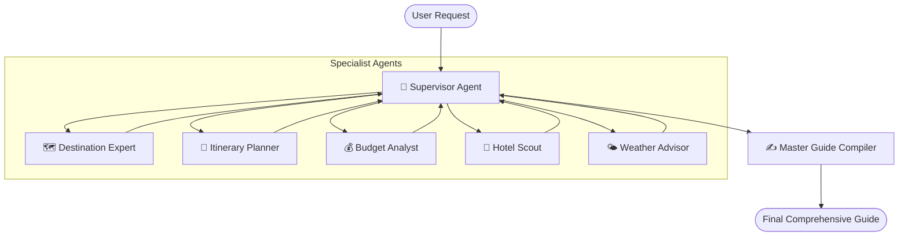

# ✈️ Voyaura — Multi-Agent AI Travel Advisor

[](https://react.dev/)
[](https://vitejs.dev/)
[](https://tailwindcss.com/)
[](https://fastapi.tiangolo.com/)
[](https://github.com/langchain-ai/langgraph)
[](https://python.org/)

> **Voyaura** is an intelligent, multi-agent travel companion that coordinates a team of specialized AI agents to craft personalized, day-by-day travel guides with real-time progress streaming, budget estimates, curated accommodations, and local insights.

---

## 🌟 Features

- 🤖 **Multi-Agent Orchestration**: Built with **LangGraph**, where a supervisor agent coordinates specialized agents for destination research, itinerary pacing, budget analysis, hotel scouting, and weather forecasting.
- ⚡ **Real-Time Streaming**: Live Server-Sent Events (SSE) update the frontend as each individual specialist agent finishes their research.
- 🎨 **Modern Minimalist UI**: Sleek dark aesthetic built with React 19, Tailwind CSS v4, Lucide icons, and responsive layouts.
- 💻 **Dual Mode Support**:
  - **Web Application**: Interactive web interface running on Vite (`http://localhost:5173`).
  - **CLI Tool**: Interactive terminal application (`python main.py`) that exports `.txt` travel guides.
- 🛡️ **LLM Error Handling**: Powered by Groq's ultra-fast Llama 3 models, with rate limiting, one retry for transient errors, and clear configuration/provider errors instead of fabricated travel results.
- 📤 **Shareable Itineraries**: Native web share integration and formatted Markdown rendering for easy reading and export.

---

## 🏗️ Multi-Agent Architecture

Voyaura models travel planning as a collaborative graph workflow:



### The Specialist Team

| Agent | Responsibility |
| :--- | :--- |
| **🧭 Supervisor** | Determines execution order, passes state context, and tracks completed agent milestones. |
| **🗺️ Destination Expert** | Uncovers historical context, must-see landmarks, hidden neighborhood gems, and cultural etiquette. |
| **📅 Itinerary Planner** | Designs realistic day-by-day schedules with balanced pacing, meal spots, and evening activities. |
| **💰 Budget Analyst** | Estimates expenses across flights, accommodation, dining, transit, and activities according to selected budget tier (*Budget*, *Mid-range*, or *Luxury*). |
| **🏨 Hotel Scout** | Handpicks 3 distinctive properties highlighting neighborhood advantages, atmosphere, and estimated nightly rates. |
| **🌤️ Weather Advisor** | Delivers seasonal climate forecasts, practical packing checklists, and weather advisory warnings. |
| **✍️ Guide Compiler** | Synthesizes all specialist reports into a single, beautifully formatted, personal travel guide. |

---

## 📁 Repository Structure

```
Travel_advisor/
├── agents/                       # Specialized LangGraph agent definitions
│   ├── supervisor.py             # Supervisor router & guide compiler
│   ├── destination_agent.py      # Destination overview & cultural highlights
│   ├── itinerary_agent.py        # Day-by-day itinerary builder
│   ├── budget_agent.py           # Financial estimations & breakdowns
│   ├── hotel_agent.py            # Accommodation recommendations
│   └── weather_agent.py          # Weather forecasts & packing checklists
├── wanderful-ui/                 # Frontend React + Vite application
│   ├── src/
│   │   ├── components/           # Header, navigation, and UI components
│   │   ├── pages/
│   │   │   ├── HeroPage.tsx      # Landing page with video background
│   │   │   ├── PlanPage.tsx      # Travel input form with live SSE progress
│   │   │   ├── ResultPage.tsx    # Formatted Markdown guide display
│   │   │   └── AboutPage.tsx     # Project and team overview
│   │   └── index.css             # Tailwind v4 theme and font definitions
│   ├── package.json              # Frontend scripts & dependencies
│   └── vite.config.ts            # Vite configuration (port 5173)
├── api.py                        # FastAPI backend serving SSE stream endpoint
├── graph.py                      # LangGraph StateGraph definition & edge wiring
├── LLM.py                        # LLM provider configuration & safe fallback wrapper
├── main.py                       # Interactive Terminal CLI interface
└── .env                          # API keys and environment variables
```

---

## 🚀 Getting Started

### Prerequisites

- **Python**: 3.10 or higher
- **Node.js**: 18.0 or higher
- **Package Manager**: `npm` or `pnpm`

---

### 1. Backend Setup

1. **Clone the repository**:
   ```bash
   git clone <repo-url>
   cd Travel_advisor
   ```

2. **Create and activate a virtual environment**:
   ```bash
   python3 -m venv venv
   source venv/bin/activate  # On Windows: venv\Scripts\activate
   ```

3. **Install Python dependencies**:
   ```bash
   pip install fastapi uvicorn langgraph langchain langchain-core langchain-groq pydantic python-dotenv
   ```

4. **Configure Environment Variables**:
   Create or edit the `.env` file in the project root:
   ```env
   GROQ_API_KEY="your-groq-api-key-here"
   ```
   > *A missing or invalid API key is reported as an error. The planner does not generate placeholder recommendations.*

5. **Start the FastAPI server**:
   ```bash
   uvicorn api:app --host 0.0.0.0 --port 8000 --reload
   ```
   The backend will be live at `http://localhost:8000`.

---

### 2. Frontend Setup

1. **Navigate to the UI directory**:
   ```bash
   cd wanderful-ui
   ```

2. **Install Node dependencies**:
   ```bash
   npm install
   ```

3. **Start the Vite development server**:
   ```bash
   npm run dev
   ```
   Open your browser at **`http://localhost:5173`**.

---

### 3. Running via Terminal CLI (Optional)

You can also run the advisor directly in your terminal without starting the web server:

```bash
python main.py
```

Follow the interactive prompts (Destination, Dates, Travelers, Budget). When complete, your travel guide is printed directly in the terminal and saved as a formatted text file (e.g., `travel_guide_Tokyo_Japan.txt`).

---

## 🔌 API Reference

### `POST /api/plan`
Initiates the multi-agent planning workflow and streams updates over SSE.

#### Request Body
```json
{
  "destination": "Kyoto, Japan",
  "travel_dates": "October 2026",
  "travelers": 2,
  "budget": "mid-range"
}
```

#### SSE Stream Events
- `start`: Workflow initiated
  ```json
  {"type": "start", "message": "Assembling your travel team for Kyoto, Japan..."}
  ```
- `agent_done`: Individual agent completed its task
  ```json
  {"type": "agent_done", "agent": "destination_agent", "label": "Destination Expert"}
  ```
- `complete`: Final guide assembled
  ```json
  {
    "type": "complete",
    "final_plan": "# Complete Travel Guide...",
    "destination_info": "...",
    "itinerary": "...",
    "budget_estimate": "...",
    "hotel_recommendations": "...",
    "weather_info": "..."
  }
  ```
- `error`: Emitted if an unhandled error occurs
  ```json
  {"type": "error", "message": "Error details..."}
  ```

### `GET /api/health`
Healthcheck endpoint returning server status.

```json
{
  "status": "ok",
  "service": "Wanderful Travel Advisor"
}
```

---

## 🛠️ Tech Stack

- **Frontend**: React 19, TypeScript, Tailwind CSS v4, Lucide React, React Router v7, React Markdown.
- **Backend**: FastAPI, Uvicorn, LangGraph, LangChain, Groq SDK.
- **LLM**: Groq `llama-3.3-70b-versatile` / `llama-3.1-8b-instant`.

---

## 📄 License

This project is open-source and available under the [MIT License](LICENSE).
